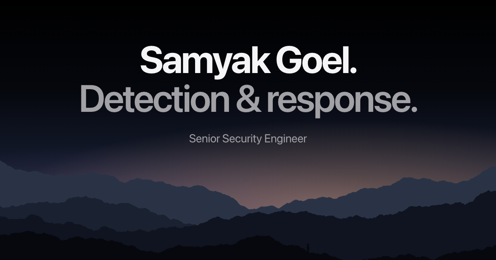

# Samyak Goel · Portfolio

Personal site of **Samyak Goel**, Senior Security Engineer specialising in detection and response: endpoint telemetry, Cortex XDR and XQL detection engineering, incident response and FortiGate network security.

**Live:** [samyakportfolio.netlify.app](https://samyakportfolio.netlify.app) · **LinkedIn:** [samyakgoel](https://www.linkedin.com/in/samyakgoel/) · **Writing:** [Medium](https://medium.com/@samyakgoel5)



## What's on the site

- **Evidence:** 36+ XQL detections, a ~90% PowerShell false-positive reduction, an XDR bypass taken apart, a SOC IR process built from zero
- **Depth:** honest skill levels (Core / Established / Emerging) instead of percentage bars
- **Work:** each role split into client work and company work
- **Projects:** [FWallSim](https://github.com/Saaamyak/fwallsim), a FortiGate-style firewall simulator that runs in the browser
- **Writing and credentials:** Medium posts and verifiable certifications

## Stack

- Plain HTML, CSS and JavaScript. No framework, no build step, no third-party scripts, about 40 KB total.
- Hosted on Netlify: every push to `main` deploys; pull requests get a Deploy Preview.
- Netlify publishes only [`public/`](public/).

## Security

Configured in [`netlify.toml`](netlify.toml):

| Control | Setting |
|---|---|
| Content Security Policy | `'self'` only, no inline scripts or styles, `frame-ancestors 'none'` |
| Transport | HSTS |
| Framing / sniffing | `X-Frame-Options: DENY`, `X-Content-Type-Options: nosniff` |
| Isolation | Cross-Origin-Opener-Policy and Cross-Origin-Resource-Policy `same-origin` |
| Privacy | Strict Referrer-Policy; Permissions-Policy denies camera, microphone, geolocation, payment, USB |
| Disclosure | [`security.txt`](public/.well-known/security.txt) and [SECURITY.md](SECURITY.md) |

The page script uses `textContent` and `createElement` only, never `innerHTML`.

## Structure

```
public/                 the website (the only folder Netlify serves)
  index.html            single page
  assets/               CSS, JS, SVG mountain layers, images
  files/                resume (PDF)
  .well-known/          security.txt
netlify.toml            publish dir, redirects, security headers
docs/                   handover: SESSION_CONTEXT.md (start here), POA.md
```

## Run locally

```bash
cd public && python3 -m http.server 8000
```

Then open http://localhost:8000. Security headers apply only on Netlify.

---

© 2026 Samyak Goel. All rights reserved. The content, writing and images are not licensed for reuse.
